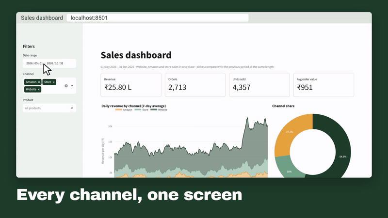

# Spreadsheet → live dashboard



**Problem.** Nearly 3,000 rows of clean sales data still don't answer the questions an owner
actually asks, such as "which channel grew this month?" or "what sold most?". Scrolling a
spreadsheet won't tell you.

**Solution.** `dashboard.py` is a Streamlit app over the cleaned data from the
[report demo](../02-sales-report-automation). Pick a date range, channels or products and every
number and chart updates.

**Result.** One click answers the October question. With the view filtered to October and to Amazon
plus the shop, revenue was up 22.0% on the previous 31 days and the Tea Lovers Gift Hamper was the
top seller.

> Demo data: a synthetic tea and coffee brand. See the report demo for how it was made and cleaned.

## What's on it

- **Headline numbers:** revenue (in lakhs), orders, units and average order value. Each is compared
  with the previous period of the same length.
- **Daily revenue by channel,** as a 7-day average, so a partial week doesn't look like a crash
- **Channel share** donut, **revenue by product** bars and a **monthly table**
- **Download** of exactly the filtered rows as a CSV
- **Shareable views:** filters can be set from the link, for example
  `?start=2026-10-01&end=2026-10-31&channels=Amazon,Store`, so you can bookmark a view or send it
  to someone

## Run it

```bash
pip install streamlit plotly pandas
cd ../02-sales-report-automation && python make_messy_data.py && python build_report.py
cd ../03-live-dashboard && streamlit run dashboard.py
```

The dashboard opens at `http://localhost:8501`.

## Adapting it to your business

It reads one tidy table, so anything that produces one can feed it: the report script, a Google
Sheet, a database or your POS export. It can run on your laptop, or be deployed online with a
password so the whole team sees the same numbers.
