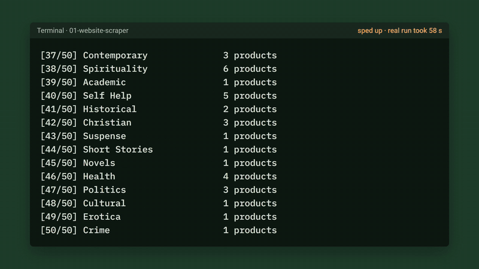
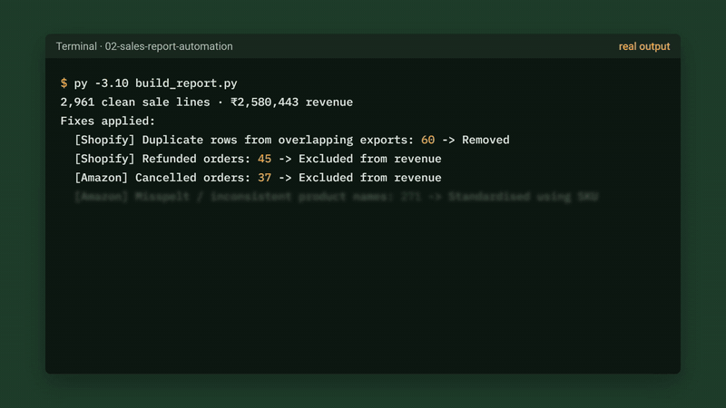

# Python automation demos

Three small tools that do boring business work automatically: pulling data off a website,
cleaning messy sales exports into one report, and turning the result into a live dashboard.
Each one runs end to end on public or sample data, so you can try it yourself in a few minutes.

| | Demo | What it does | Result |
|---|---|---|---|
|  | [**Website → spreadsheet**](01-website-scraper) | Crawls every category of an online catalogue and writes a formatted Excel workbook | 1,000 products from 50 categories in 58 seconds |
|  | [**Messy exports → one report**](02-sales-report-automation) | Merges three inconsistent sales exports, fixes the data and builds a report | 9 kinds of problem fixed and logged across 3,186 rows |
|  | [**Spreadsheet → live dashboard**](03-live-dashboard) | An interactive dashboard over the cleaned data, filterable by date, channel and product | Answers "what changed this month?" in a click |

## Run them

Python 3.10+.

```bash
pip install -r requirements.txt

cd 01-website-scraper
python scrape_books.py

cd ../02-sales-report-automation
python make_messy_data.py
python build_report.py

cd ../03-live-dashboard
streamlit run dashboard.py
```

Demo 3 reads the cleaned data that demo 2 writes, so run demo 2 first.

## Honest notes

- The scraper targets [books.toscrape.com](https://books.toscrape.com), a site built for scraping
  practice. Real sites need their terms and robots.txt checked first, and some need a browser-based
  approach.
- The sales data in demos 2 and 3 is synthetic, made to behave like a small Indian tea and coffee
  brand's real exports. The problems in it (typos, duplicate rows, mixed date formats, prices stored
  as text) are the ones real exports have.

## About

I'm Bhavya Shukla, a computer science graduate (VIT, 2026). I build
Python tools that replace manual spreadsheet and data work, and I've shipped a production Android
app, [THI Comfort](https://play.google.com/store/apps/details?id=com.bhavyashukla.thitracker), on Google Play.

Have a task your team does by hand every week? Email **bhavyashukla.official@gmail.com** or find me
on [LinkedIn](https://www.linkedin.com/in/bhavyashukla29/).
